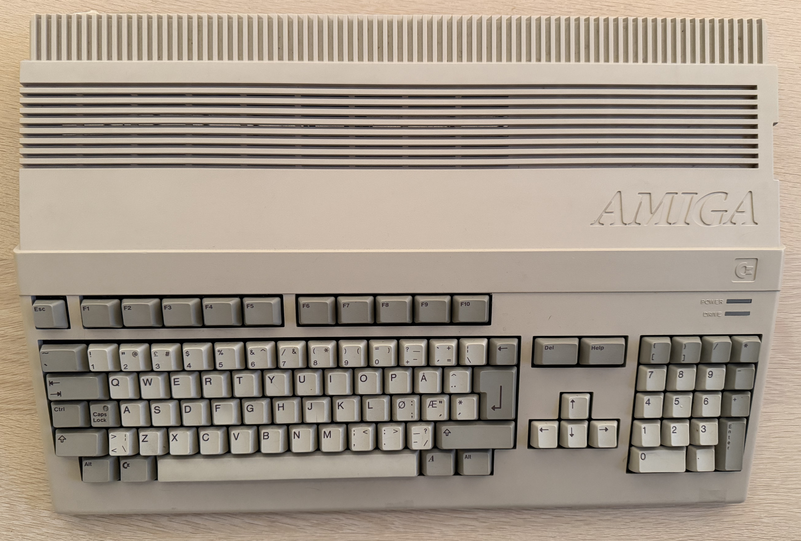
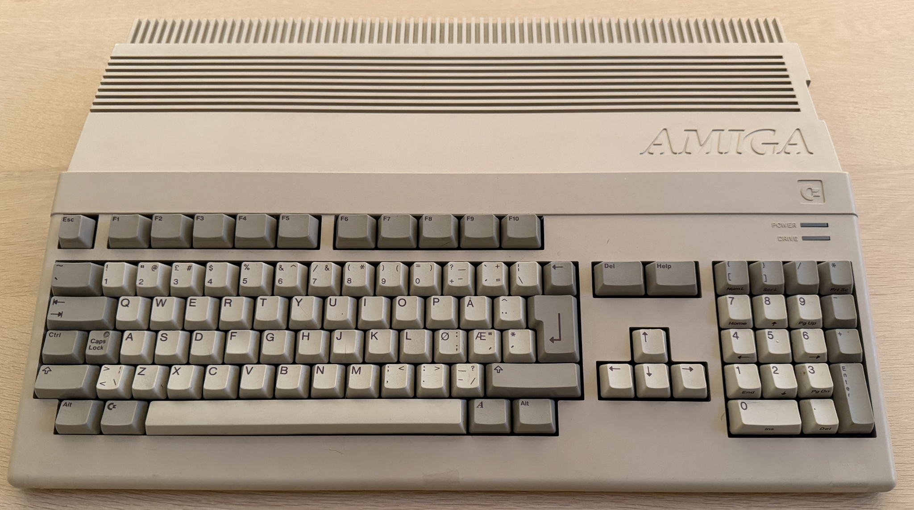
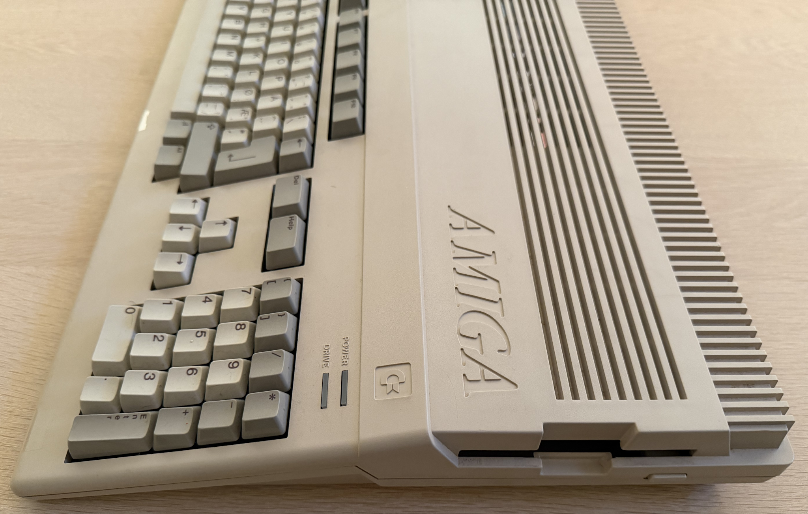
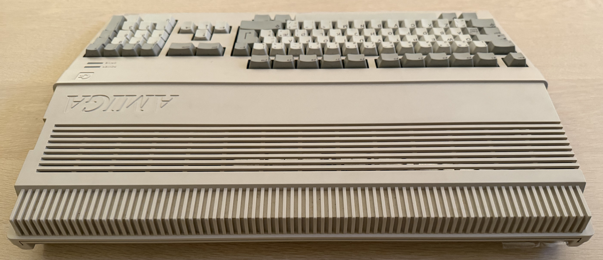
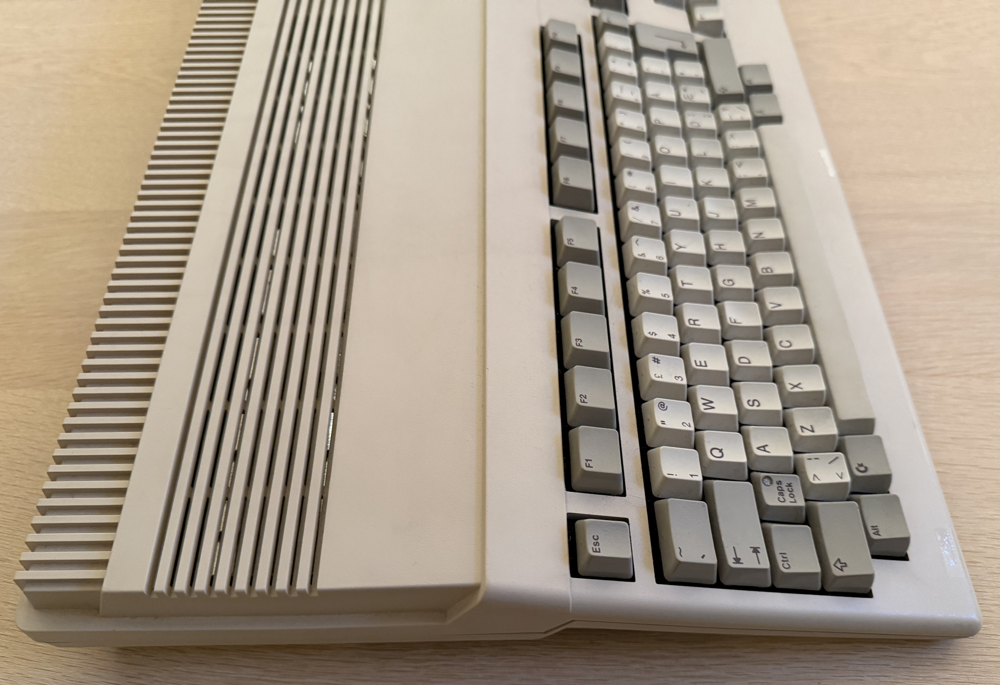
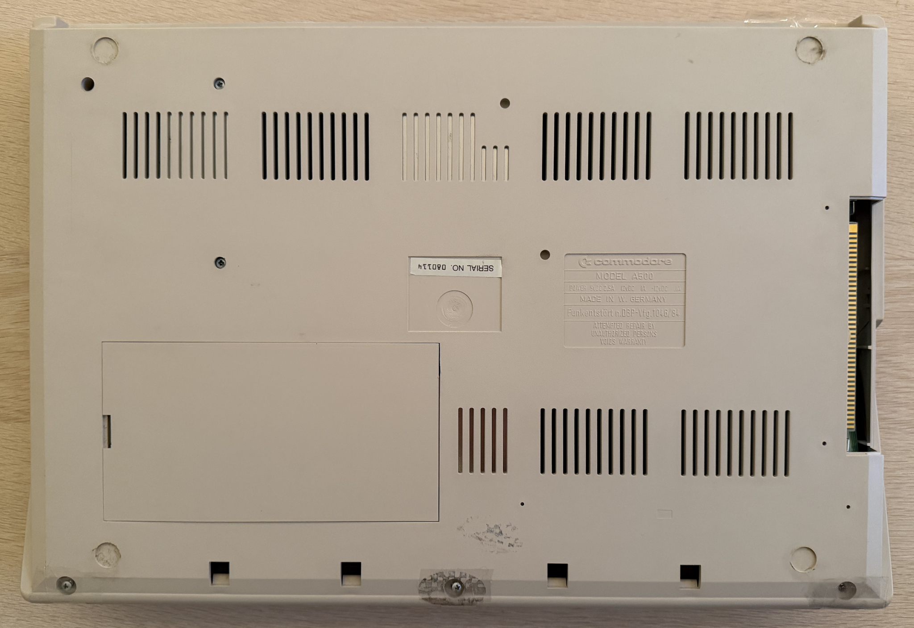

    

# Amiga 500

 

# Table of contents

<!-- TABLE OF CONTENTS -->

TOC - Click to enlarge

  <ul>
    <li>
      <a href="#starting-point">Starting point</a>
    </li>
    <li>
      <a href="#refurbishment-activities">Refurbishment activities</a>
    </li>
    <li>
      <a href="#initial-testing">Initial testing</a>
    </li>
    <li>
      <a href="#disassembly">Disassembly</a>
    </li>
    <li>
      <a href="#mainboard">Mainboard</a>
      <ul>
        <li>
          <a href="#visual-inspection">Visual inspection</a>
        </li>
        <li>
          <a href="#checking-the-voltages">Checking the voltages</a>
        </li>
        <li>
          <a href="#troubleshooting-and-repair">Troubleshooting and repair</a>
        </li>
      </ul>
    </li>
    <li>
      <a href="#keyboard">Keyboard</a>
      <ul>
        <li>
          <a href="#initial-testing">Initial testing</a>
        </li>
        <li>
          <a href="#disassembly">Disassembly</a>
        </li>
        <li>
          <a href="#cleaning">Cleaning</a>
        </li>
        <li>
          <a href="#reassembly">Reassembly</a>
        </li>
      </ul>
    </li>
    <li>
      <a href="#casing">Casing</a>
      <ul>
        <li>
          <a href="#cleaning-the-covers">Cleaning the covers</a>
        </li>     
      </ul>
    </li>
    <li>
      <a href="#testing">Testing</a>
    </li>
    <li>
      <a href="#final-result">Final result</a>
    </li>
  </ul>

# Starting point

Chickenlips. Yes, Chickenlips. This is an Amiga 500 with the much sought after mechanical keyboard which was used in the early models of this magnificent machine. You can see the "Chickenlips" Commodore logo on the left side, located between the spacebar and the ALT key. When you see this "Chickenlips" you know that this is a mechanical keyboard. Later models of the Amiga 500 have the *italic "A"* symbol instead. Also, early Amiga 500 models have the embossed Commodore logo on the right hand side, just above the keyboard. Later model only have the Commodore logo on a sticker. And a small little detail: early Amigas have a RED power LED (not the GREEN which was used in later models).

Nevertheless, back to the job. From a starting point the first thing to notice is that there are one screw missing, and most of the other screws are held in place with tape. This is reported to be one of the problems requested to look into. Another issue is the side panel on the left hand side which is gone missing.

There is some dust and grease on the covers and the keyboard, but nothing substantial. The machine is expected to be working, but it is reported to have had some issues early on. The covers are not very yellowed - as is the same for the keyboard.

Below are some pictures of the machine before refurbishment (click to enlarge).

    
    
    
    
    
    

# Refurbishment activities

The planned refurbishment activities for this Amiga 500 are listed below. The order may vary, and several activities may be carried out in parallel:

- [ ] Refurbish the casing
- [ ] Refurbish mainboard
- [ ] Refurbish the keyboard
- [ ] Testing and validation

The plan can be updated during the refurbishment process. Sometimes I discover areas that need special attention.
 

# Initial testing

Before the refurbish commence, the Amiga 500 is connected to a TV set and powered on. This is to get an understanding of health of the machine. It is not meant as a complete test, but as an initial test.

The results are shown in the table below:

  
| Test area | Test criteria | Result | Comment |
|:----------|:----------|:----------:|:----------|
| Boot up | ROM boot up screen is displayed | PASSED | Kickstart 1.2 |
| Floppy | Floppy drive is ticking | PASSED |  | 
| LED | LED lights are lit correct | PASSED | RED power light|
| RAM | No errors on memory scan | PASSED | Amiga Test Kit |
| Audio | Music/Sinewave plays normal | PASSED | Amiga Test Kit |
| Video | No visual errors  | PASSED | Amiga Test Kit |
| CIA | No timer errors  | PASSED | Amiga Test Kit |
| Keyboard | All keys are registered  | PASSED | Amiga Test Kit |

# Disassembly

Disassembling the Amiga 500 is straightforward. First is to remove the six screws at the underside of the machine. But, as mentioned earlier, there are only five screws on this Amiga 500. And the screws are covered with some tape. 

But I notice that someone has been here before - there is a fine mix of torx and Phillips screw (three of each kind). Also, both the warranty seal on the rear (not visible in the picture below) and the seal seen in the picture are broken. In addition, the three machine screws holding the internal floppy drive are also missing.

    

