

    

# Amiga 500

 

# Table of contents

<!-- TABLE OF CONTENTS -->

TOC - Click to enlarge

  <ul>
    <li>
      <a href="#starting-point">Starting point</a>
    </li>
    <li>
      <a href="#refurbishment-activities">Refurbishment activities</a>
    </li>
    <li>
      <a href="#initial-testing">Initial testing</a>
    </li>
    <li>
      <a href="#disassembly">Disassembly</a>
    </li>
    <li>
      <a href="#mainboard">Mainboard</a>
      <ul>
        <li>
          <a href="#visual-inspection">Visual inspection</a>
        </li>
        <li>
          <a href="#checking-the-voltages">Checking the voltages</a>
        </li>
        <li>
          <a href="#troubleshooting-and-repair">Troubleshooting and repair</a>
        </li>
      </ul>
    </li>
    <li>
      <a href="#keyboard">Keyboard</a>
      <ul>
        <li>
          <a href="#initial-testing">Initial testing</a>
        </li>
        <li>
          <a href="#disassembly">Disassembly</a>
        </li>
        <li>
          <a href="#cleaning">Cleaning</a>
        </li>
        <li>
          <a href="#reassembly">Reassembly</a>
        </li>
      </ul>
    </li>
    <li>
      <a href="#casing">Casing</a>
      <ul>
        <li>
          <a href="#cleaning-the-covers">Cleaning the covers</a>
        </li>     
      </ul>
    </li>
    <li>
      <a href="#testing">Testing</a>
    </li>
    <li>
      <a href="#final-result">Final result</a>
    </li>
  </ul>

# Starting point

Chickenlips. Yes, Chickenlips. This is an Amiga 500 with the much sought after mechanical keyboard which was used in the early models of this magnificent machine. You can see the "Chickenlips" Commodore logo on the left side, located between the spacebar and the ALT key. When you see this "Chickenlips" you know that this is a mechanical keyboard. Later models of the Amiga 500 have the *italic "A"* symbol instead. Also, early Amiga 500 models have the embossed Commodore logo on the right hand side, just above the keyboard. Later model only have the Commodore logo on a sticker. And a small little detail: early Amigas have a RED power LED (not the GREEN which was used in later models).

Nevertheless, back to the job. From a starting point the first thing to notice is that there are one screw missing, and most of the other screws are held in place with tape. This is reported to be one of the problems requested to look into. Another issue is the side panel on the left hand side which is gone missing.

There is some dust and grease on the covers and the keyboard, but nothing substantial. The machine is expected to be working, but it is reported to have had some issues early on (such as the floppy drive being very sensitive with disk detection). The covers are not very yellowed - as is the same for the keyboard.

Below are some pictures of the machine before refurbishment (click to enlarge).

    
    
    
    
    
    

# Refurbishment activities

The planned refurbishment activities for this Amiga 500 are listed below. The order may vary, and several activities may be carried out in parallel:

- [ ] Refurbish the casing
- [ ] Refurbish mainboard
- [ ] Refurbish the keyboard
- [ ] Testing and validation

The plan can be updated during the refurbishment process. Sometimes I discover areas that need special attention.
 

# Initial testing

Before the refurbish commence, the Amiga 500 is connected to a TV set and powered on. This is to get an understanding of health of the machine. It is not meant as a complete test, but as an initial test.

The results are shown in the table below:

  
| Test area | Test criteria | Result | Comment |
|:----------|:----------|:----------:|:----------|
| Boot up | ROM boot up screen is displayed | PASSED | Kickstart 1.2 |
| Floppy | Floppy drive is ticking | PASSED |  | 
| LED | LED lights are lit correct | PASSED | RED power light|
| RAM | No errors on memory scan | PASSED | Amiga Test Kit |
| Audio | Music/Sinewave plays normal | PASSED | Amiga Test Kit |
| Video | No visual errors  | PASSED | Amiga Test Kit |
| CIA | No timer errors  | PASSED | Amiga Test Kit |
| Keyboard | All keys are registered  | PASSED | Amiga Test Kit |

# Disassembly

Disassembling the Amiga 500 is straightforward. First is to remove the six screws[^1][^2] at the underside of the machine. But, as mentioned earlier, there are only five screws on this Amiga 500. And the screws are covered with some tape. Also, one of the screws at the rear side is longer than the rest (9.5 mm)[^2]. 

    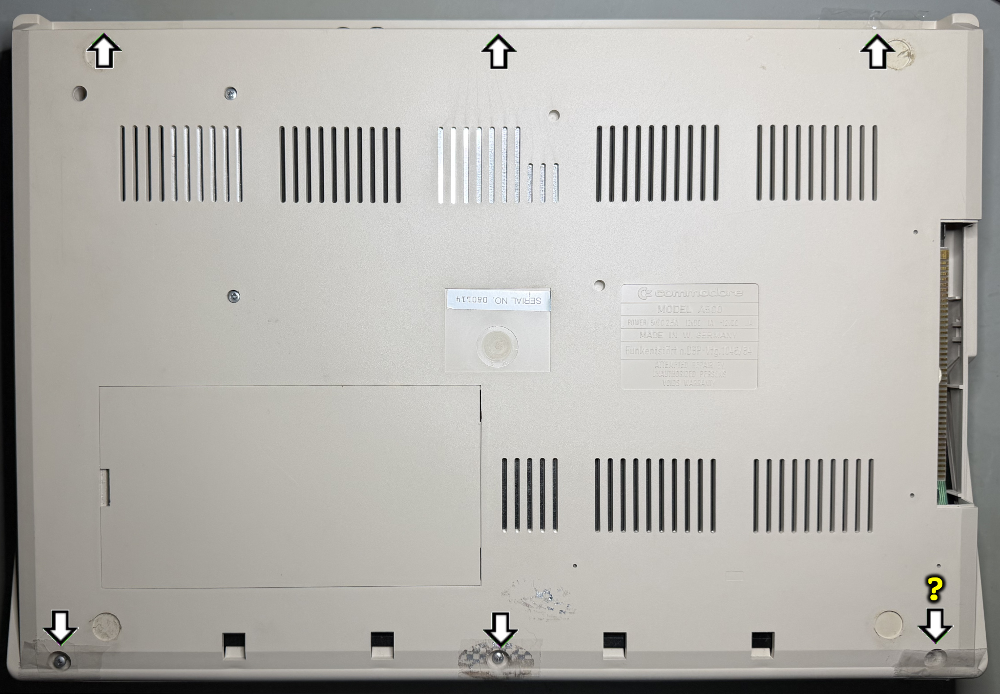

With the six (five!) screws put of the way the machine is flipped back to upright position. Now the top cover is carefully pried off - note that there are two small plastic clips in the slit on each side of the covers. I recommend using a thin plastic spudger when releasing the small clips.

    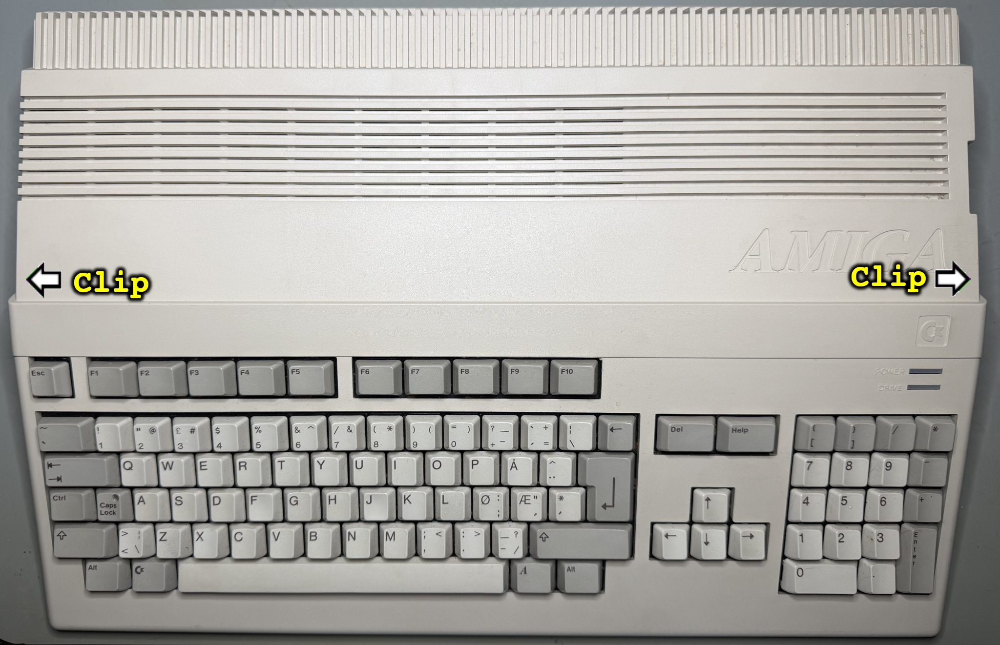

    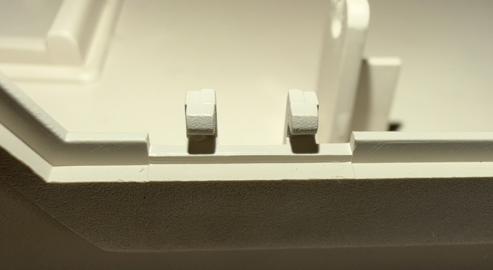

The top cover is lifted away and the interior is exposed. The first things I notice is that the floppy drive is previously refurbished by [retrofix.co.uk](https://retrofix.co.uk/), and that there are some corrosion on both the floppy drive and the keyboard metal backside plate.

    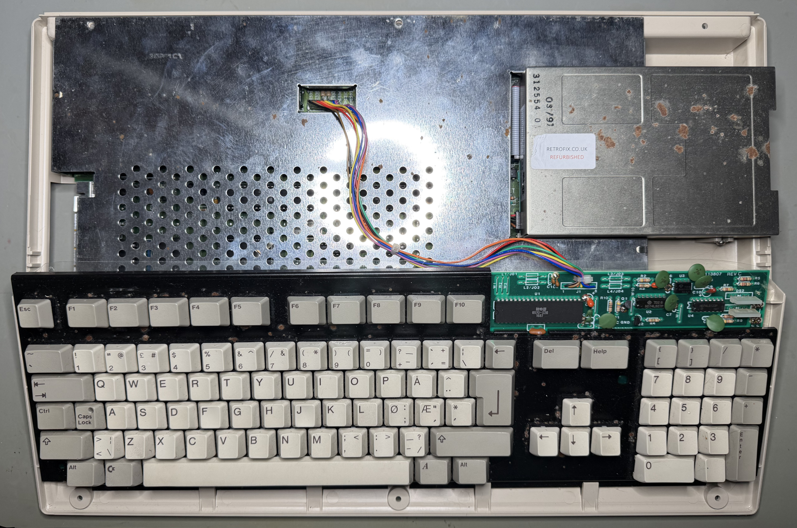

Next action is to remove the keyboard. This is done by simply (carefully) pulling the 8-pin connector (of which only seven pins are used). **NOTE:** Take care to remember the original direction of the keyboard connector as this can be installed the wrong way when re-assembling. When the keyboard is removed the whole RF-shield is exposed. The RF-shields is almost without any corrosion. It looks like the four metal tabs are intact - which is not that common. These are quite fragile and easily break.

Also, there is a 512 kB RAM module installed. This is pulled out of the machine as part of the disassembly.

    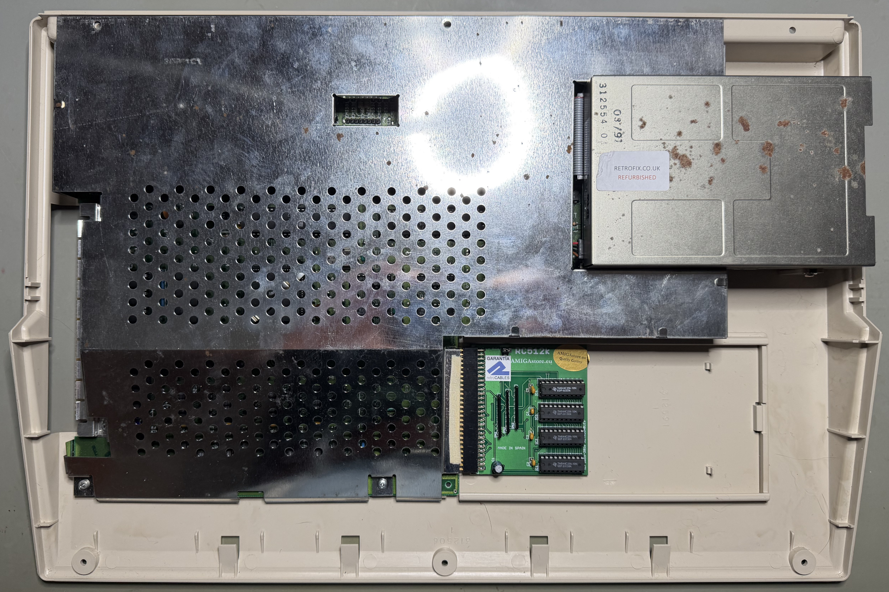

The four Phillips head screws[^3] are removed (see white arrows above), the four metal tabs are folded to upright position (see black arrows above) and the metal RF-shield is lifted from the mainboard. **NOTE:** When removing the RF-shield make sure to clean it properly soon after. The metal shield will easily start to corrode if there are fat/grease from human hands.

    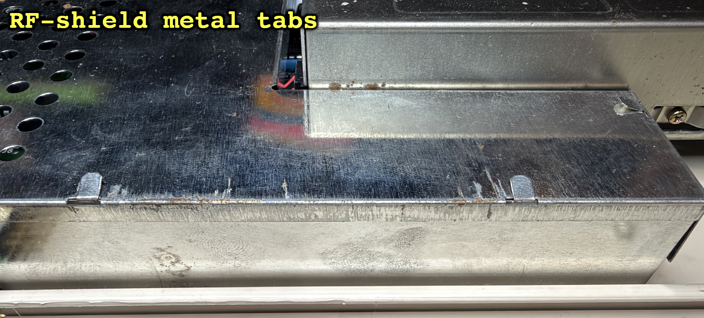

    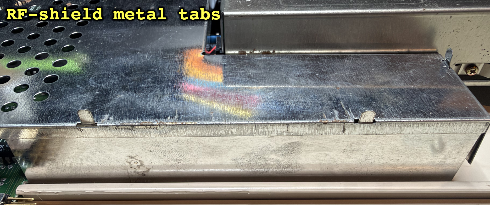

With the RF-shield removed the mainboard is exposed. And it looks to be in very good condition at first glance. There are some dust inside, but other than that it looks very nice. A thorough visual inspection of the mainboard will be done later.

    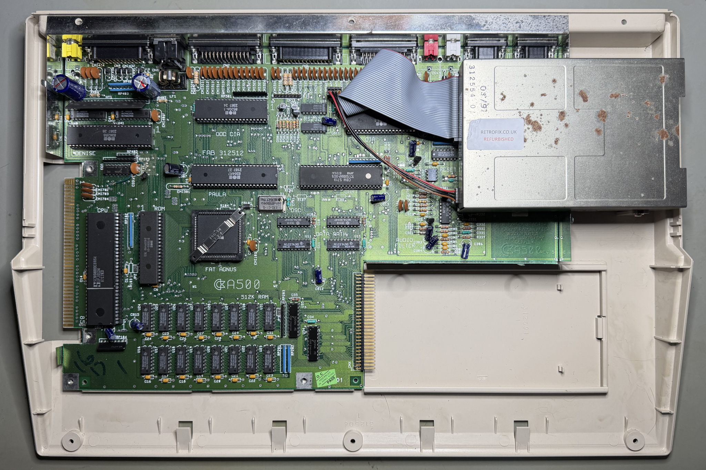

The bottom cover and the bottom RF-shield also seem to be in fine condition too. There are some dust, but other than that I think this looks great.

    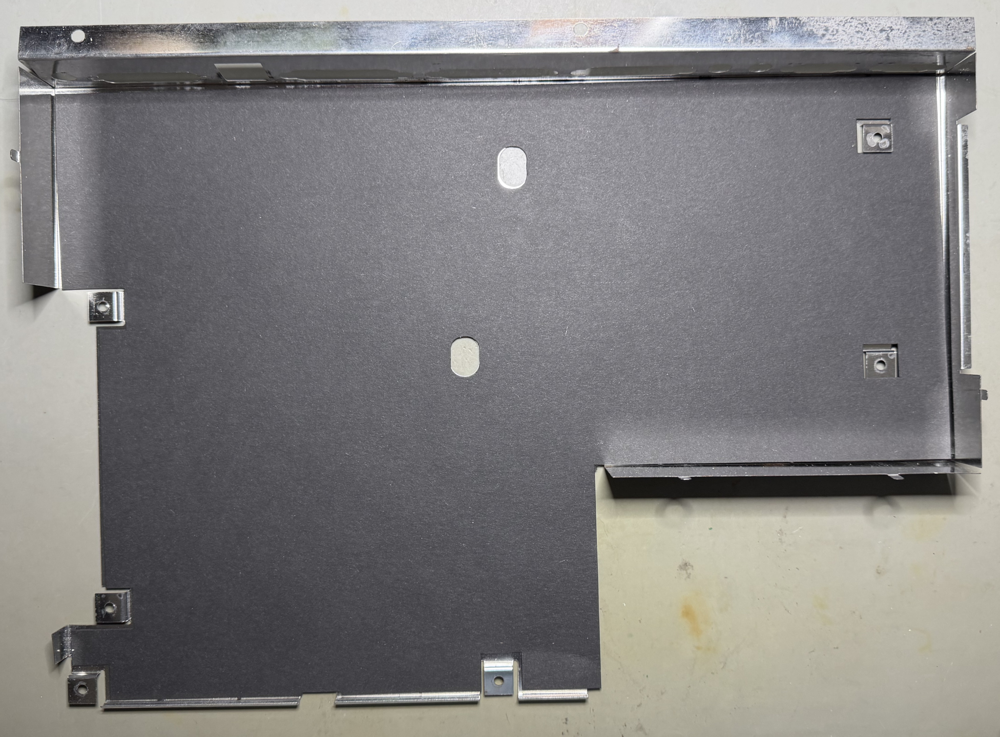

    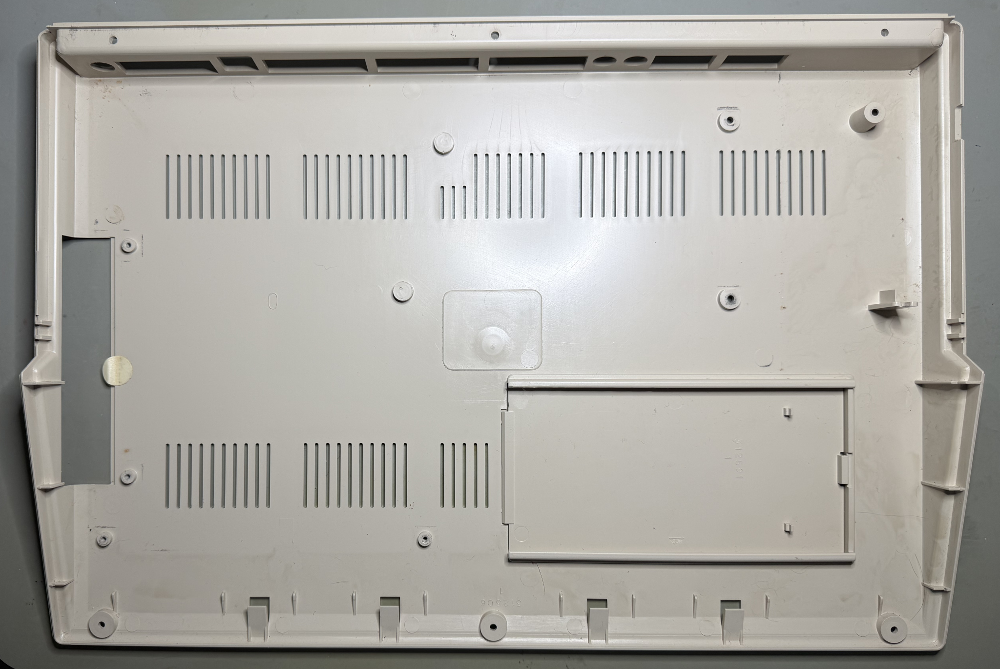

Notice that to remove the mainboard from the RF-shield all the 12 hex nut bolts (5mm ) needs to be removed.

    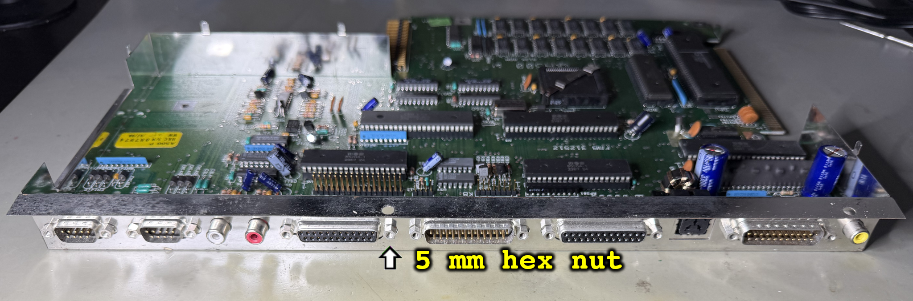

# Mainboard

This mainboard is the Assy 312510/Artwork 312513 Rev 5. This is one of the earlier revisions with the older Fat Agnus and eight RAM chips.

## Visual inspection

UPDATE TEXT

The mainboard appears to be in fine condition. I can not see any signs of either damage or repair. There is of course the normal amount of dust laying around on the mainboard, but that is to be expected after so many years. On the backside of the mainboard there are some flux residue where some of the connectors are soldered to the mainboard. There is a small resistor soldered to the backside of the mainboard, but I think this is from factory.

Some of the solder on the front side of the mainboard is a bit dull looking. But I do not think this is due to any leakage. Instead, my guess is that is due to using lead-free solder. I can not see any kind of leakage from capacitors - or bulging capacitors.

In the table below all the major custom IC found on the mainboard are listed. As can be seen from the table the custom MOS chips were produced during a time interval from week 14 in 1987 to week 23 in 1987. I think it is a fair guess that this Amiga 500 were manufactured sometime in the summer or early autumn of 1987. The same summer the song La Bamba (Los Lobos) were played non-stop on the radio...

  
| Chip/Area | Manufactor | Version | Date code | Socket | Note |
|:----------:|:----------:|:----------:|:----------:|:----------:|:----------:|
| CPU | SIGNETICS | SCN68000C8N64 | W17 Y1987 | Yes |  |
| KICKSTART | MOS | 315093-01 | Unknown | Yes | Kickstart 1.2 |
| DENISE | MOS | 8362R8 | W23 Y1987 | Yes | |
| FAT AGNUS | CSG | 8371  | W19 Y1987 | Yes | OCS |
| PAULA | MOS | 8364R7 | W21 Y1987 | Yes | |
| GARY | CBM | 5719 TC17G008AP-0025 | W21 Y1987 | Yes | |
| ODD CIA | MOS | 8520 A-1 | W23 Y1987 | Yes | |
| EVEN CIA | MOS | 8520 A-1 | W23 Y1987 | Yes | |
| RAM | TEXAS INSTRUMENTS | TMS4256-15NL | W14 Y1987 | No | |
| DATA PATH | TEXAS INSTRUMENTS | SN74LS373N | W19 Y1987 | No | U11, U13 |
| DATA PATH | HITATCHI | HD74LS244P | Unknown | No | U10, U12 |

Below are some pictures of the mainboard before repair and refurbish.

    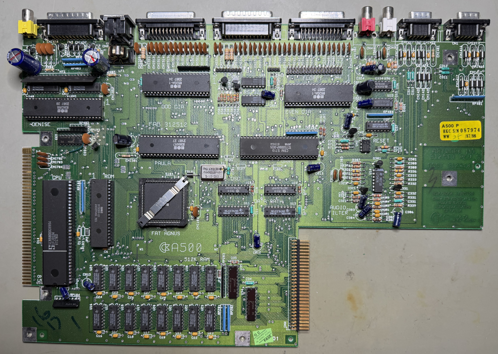

    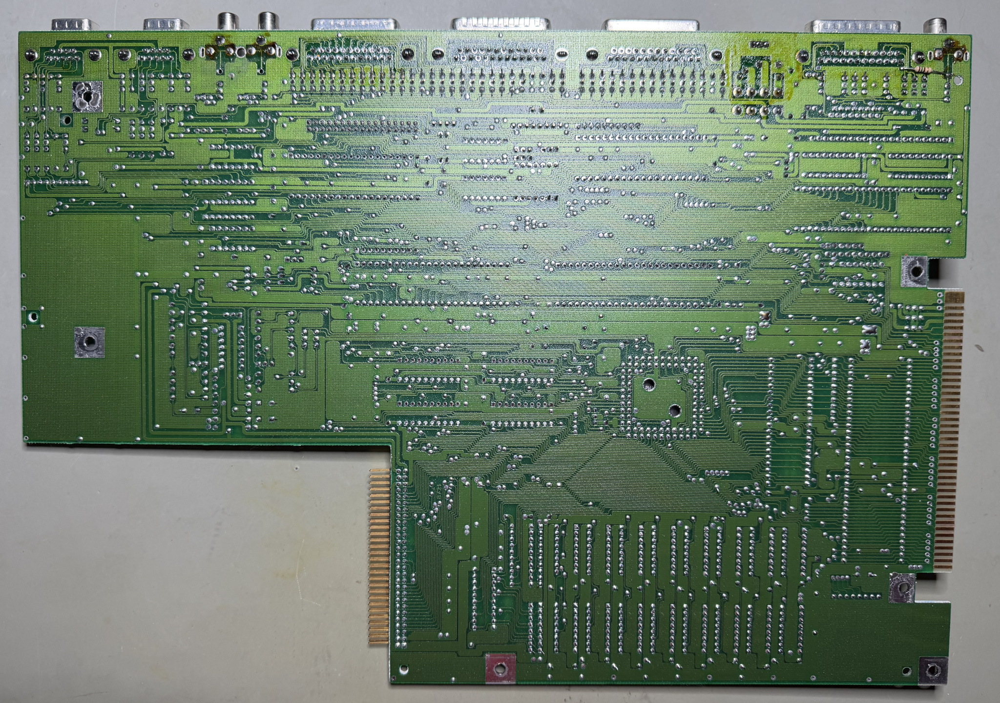

## Checking the voltages

It is good practice to measure the voltages - to verify that all voltages are present and within tolerances. Voltages which are not within acceptable tolerances are often a symptom of faults (just like a doctor would check temperature and blood samples).

As the table below show all voltages are present and ok. Note that this table will be updated after completing the refurbish.

    
| Measure point | Target voltage | Measured voltage (Before refurbish) | Measured voltage (After refurbish) | Note |
|:----------:|:----------:|:----------:|:----------:|:----------:|
| PSU (5V) / VCC | +5 V DC | 5.119 V | TBD V | C815 |
| PSU (12V) / VCC | +12 V DC | 12.18 V | TBD V | C821 |
| PSU (-12V) / VCC | -12 V DC | -12.06 V | TBD V | C822 |
| PSU (5V) / VCC | +5 V DC | 5.121 V | TBD V | Pin #14 U33 |

# Keyboard

The keyboard is the desirable "Chickenlips" mechanical keyboards (HI-TEK Corporation // Serial No. 15187047 // A/W 113806 REV C // HCS-55 94V-0. It appears to be in ok condition, but there is a significant amount of corroded spots on the metal frame. It is quite dirty - the keypcaps are covered with old grease and grime. But the keyboards feels nice to the touch, and appears to be undamaged. There is not much yellowing either. Below are some picture of the keyboard before refurbishment.

    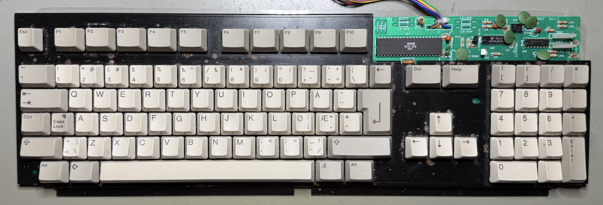

    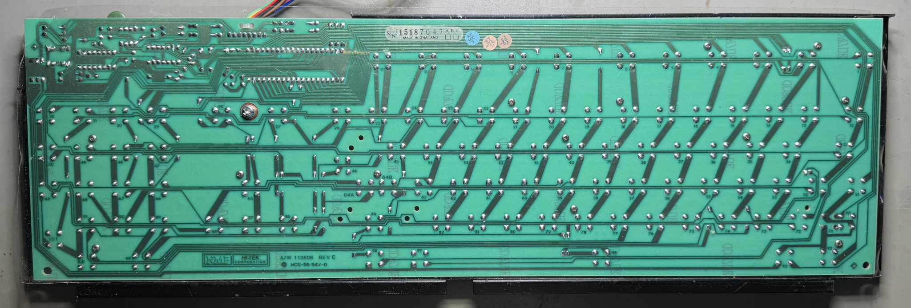

## Initial testing

Before the keyboard is disassembled it is tested using the [Amiga Test Kit](https://refurbished-commodore.com/tools) software. But now I notice something strange: the "S" key is quite iffy. It does not feel like responding as it should. As can be seen from the picture below all keys are working fine (with the exception of the "S" key which is not).

    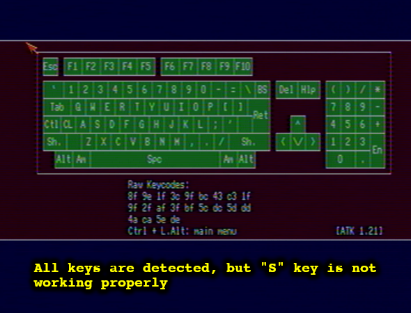

## Disassembly

All the 96 keycaps are carefully removed with a [keycap puller](https://refurbished-commodore.com/tools). Amongst these, there are six keycaps which requires special attention when removed. **NOTE:** When pulling the keycaps be very gentle. The "Chickenlips" keycaps should come off very easily, but from time to time you are likely to pull the whole switching mechanism out.

    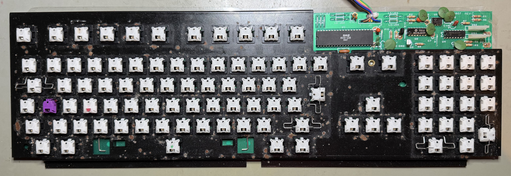

The following five keycaps all have a metal "U" shaped bracket used to stabilise the keycap:

- **ENTER** key on the numpad
- **0** key on the numpad
- **ENTER** key on the main keyboard
- Right **SHIFT**
- **TAB** key

With the keycaps out of the way, it is easy to see that there is quite some corrosion on the metal plate. I will try to remove some of this, but most is likely to stay behind. It is so hard to remove all these spots. And they do not harm the keyboard in any way.

The white "S" key top is lifted to see if I can find out why it is to iffy. And, hm, what is this? Inside the white cap there is some "stuff" (it looks like some kind of organic rubber?), and the two metal arms are cut and bent. This is, without any doubt, the reason for why the key is not working as it should. My guess is that this key has been heavily used, and in an attempt to repair the key a previous owner has made a little hack.
**Footnotes**

[^1]: Phillips pan head (5.5 mm), Sheet metal screw, Fully threaded, Thread diameter: 3.0 mm, Fastener length: 8.0 mm
[^2]: Phillips pan head (5.5 mm), Sheet metal screw, Fully threaded, Thread diameter: 3.0 mm, Fastener length: 9.5 mm
[^3]: Phillips pan head (5.5 mm), Sheet metal screw, Fully threaded, Thread diameter: 3.0 mm, Fastener length: 8.0 mm

